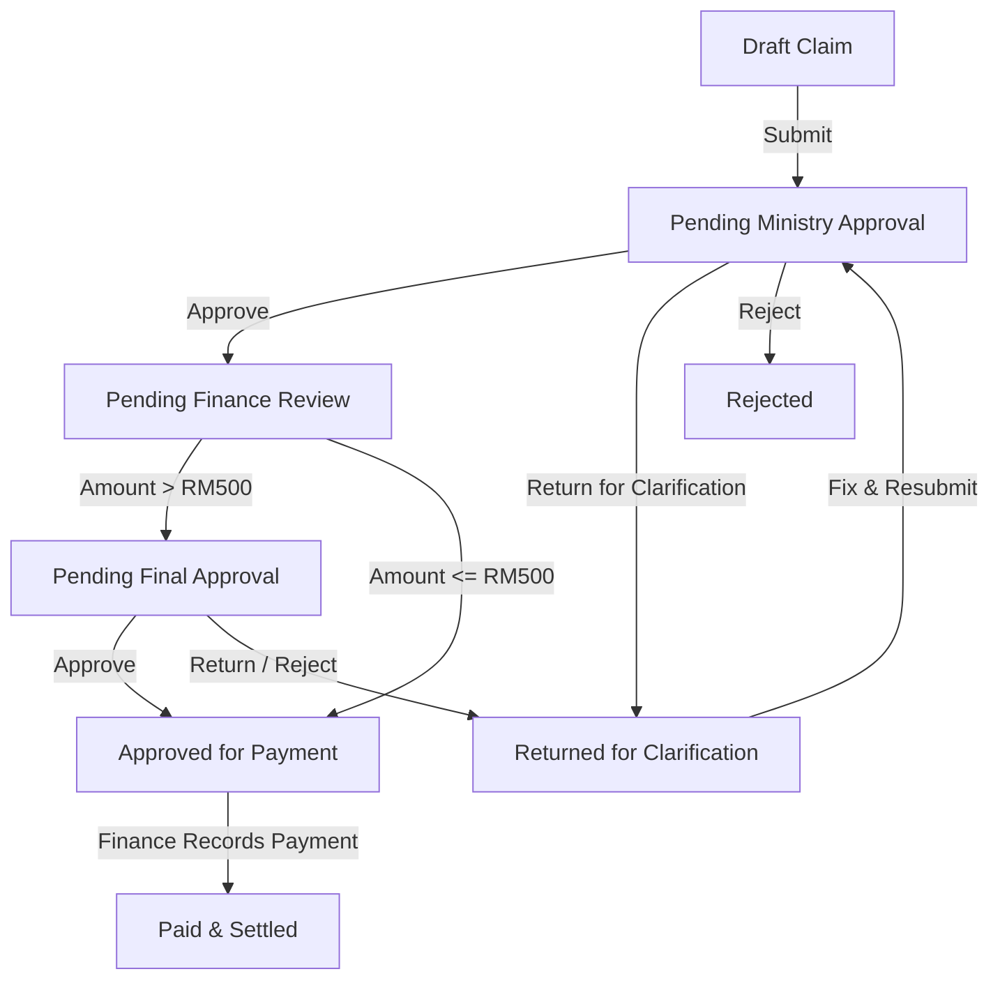

# NewLife Expense Claim Management System (NLCC)

A production-grade, full-stack expense claim management, multi-tier approval workflow, and financial reimbursement web application built for church administration and ministry teams.

---

## 📌 Executive Summary

**NewLife Expense Claim Management System** digitizes and modernizes the complete lifecycle of church ministry expenditure:
- **Paperless multi-item claim submissions** with photo/PDF receipt uploads.
- **Dynamic configurable workflow routing** matching ministry, categories, and configurable threshold rules (e.g. `<= RM 500` vs `> RM 500` executive sign-off).
- **Role-Based Access Control (RBAC)** across Claimants, Ministry Leaders, Finance Officers, Final Approvers, and System Administrators.
- **Finance Module** with receipt audit, administrative metadata correction, bank payment recording, and ledger CSV/Excel exports.
- **Printable official reimbursement vouchers** ready for physical archiving and audit signatures.
- **Immutable security audit trail** capturing every workflow transition, decision rationale, and payment action.

---

## 🚀 Key Features

### 1. Robust Claim Lifecycle


### 2. Multi-Section Claim Entry Form
- **Section A: Claimant Profile** (auto-populated name, email, phone, bank account).
- **Section B: Claim & Ministry Context** (Ministry department, programme/event, cost centre budget line, payment method, ministry justification).
- **Section C: Itemized Expenses** (Multiple line items, date, category, merchant, amount in RM, real-time subtotal).
- **Section D: Supporting Documents & Receipts** (Drag & drop PDF, JPG, PNG, Excel; size and MIME checks).
- **Section E: Claimant Declaration** (Digital confirmation statement with audit timestamp).

### 3. Approvals Inbox & Governance
- **Self-Approval Prevention**: Claimants can never approve their own claims; the system automatically routes to alternate configured approvers.
- **Mandatory Comments**: Returning or rejecting claims strictly requires explanatory notes for claimant visibility.
- **Snapshot Workflow History**: Workflow steps are frozen at submission time to ensure historical claims remain accurate when organization structures evolve.

### 4. Finance & Reimbursement Workspace
- Real-time KPI summary cards (Awaiting Review, Queued for Payment, Disbursed Month Total).
- Receipt verification badges and administrative correction modal (audited).
- Payment settlement recording (EFT reference number, date, bank method).
- Interactive expenditure analytics by ministry and category powered by Recharts.
- One-click Excel/CSV ledger export.

### 5. Administration Control
- User directory with 1-click active/inactive toggle and multi-role assignment.
- Ministries & department head approver management.
- Expense categories & Budget cost centres.
- Approval workflow rules engine and RM 500 threshold customization.
- Append-only security audit log inspector.

---

## 🛠️ Technology Stack

- **Frontend**: Next.js 14 (App Router), React 18, TypeScript, Tailwind CSS, Lucide Icons, shadcn UI components.
- **Data & Tables**: TanStack Table, Recharts.
- **Form & Validation**: Zod, React Hook Form.
- **Backend & Database**: PostgreSQL, Supabase (Auth, Row Level Security, Storage, RPC).
- **Testing**: Vitest with unit and integration test coverage for calculation precision, sequential claim numbering, workflow routing, and permissions.

---

## ⚡ Quick Start & Local Development

### 1. Clone & Install Dependencies
```bash
git clone https://github.com/newlife/expense-system.git
cd NLCC
npm install
```

### 2. Environment Variables
Copy the example environment configuration:
```bash
cp .env.example .env.local
```

### 3. Run Automated Tests
```bash
npm test
```

### 4. Start Development Server
```bash
npm run dev
```
Open [http://localhost:3000](http://localhost:3000) in your browser.

---

## 👥 Demo Personas (1-Click Switcher)

The application includes an instant **Demo Role Switcher** in the top navigation header:

| Persona | Name | Primary Role | Testing Context |
|---|---|---|---|
| **Claimant** | Jaeden Ting | `CLAIMANT` | Submits claims, uploads receipts, edits returned vouchers |
| **Ministry Leader** | Sarah Tan | `MINISTRY_LEADER` | Reviews & approves youth department claims |
| **Finance Officer** | Michael Chen | `FINANCE_OFFICER` | Verifies receipts, records payments, exports reports |
| **Final Approver** | Pastor David Wong | `FINAL_APPROVER` | Senior Pastor executive approval for high-value claims (> RM500) |
| **System Admin** | Rachel Lee | `SYSTEM_ADMIN` | Configures workflows, ministries, users, and audit trail |

---

## 📦 Database Schema & Supabase Setup

The `supabase/migrations/` directory contains complete production-ready DDL migrations:
1. `20260909000001_initial_schema.sql`: Core relational tables (`profiles`, `roles`, `ministries`, `cost_centres`, `expense_categories`, `claims`, `claim_expenses`, `claim_attachments`, `approval_rules`, `claim_workflow_steps`, `approval_actions`, `payments`, `audit_logs`).
2. `20260909000002_functions_triggers_rls.sql`: Atomic sequential claim numbering (`NLCC-YYYY-000000`), total recalculation trigger, workflow instantiator, and Row-Level Security policies.
3. `20260909000003_seed_data.sql`: Seed data for church departments, cost centres, categories, and test users.

To apply to your live Supabase project:
```bash
npx supabase db push
# or run the migration files in the Supabase SQL Editor
```

---

## 🧪 Acceptance Scenario Verification

The system successfully executes the complete end-to-end acceptance flow:
1. **Jaeden Ting** creates a claim for **Youth Ministry** (`Youth Camp`), Cost Centre `YOUTH-2026`.
2. Adds two expense items:
   - `2026-09-01`: Transportation (Grab to venue) — **RM 45.00**
   - `2026-09-02`: Meals / Hospitality (Volunteer lunch) — **RM 180.50**
   - **Total: RM 225.50**
3. Uploads 2 receipts and confirms the digital declaration.
4. On submission, the system assigns claim number **`NLCC-2026-000123`**.
5. **Sarah Tan (Youth Leader)** opens her approval inbox, inspects receipts, and clicks **Approve Claim**.
6. Because **RM 225.50 <= RM 500.00**, the claim routes directly to **Finance**.
7. **Michael Chen (Finance Officer)** verifies receipts and records payment:
   - Payment Date: `2026-09-10`
   - Reference: `MBB-TRX-839291`
   - Marks claim **`PAID`**.
8. Jaeden receives notification; his dashboard updates to **`PAID`** and the printable voucher reflects all timestamps and signatures.

---

© 2026 NewLife Community Church. All rights reserved.

### ⚙️ Admin Form Customization & Master Data Editing

Administrators can configure the claim form format, rules, and all master data without touching any code:

1. **Claim Form Format & Customization (`/admin/settings`)**:
   - **Customizable Declaration Statement**: Update the legal/church compliance text claimants must agree to before submitting.
   - **Form Guidance Callout Banner**: Set helpful guidance text displayed to church members and volunteers.
   - **Ministry Selection Locking**: Toggle whether claimants can change their default assigned ministry.
   - **Field Requirements**: Enforce mandatory merchant/vendor names and mandatory receipts.
   - **Active Payment Methods**: Toggle allowed reimbursement methods (Personal Reimbursement, Church Card, Direct Vendor Payment, Other).
   - **File Upload Limits**: Configure max file size (MB) and max attachment count.

2. **Master Data CRUD (`/admin/...`)**:
   - **Ministries (`/admin/ministries`)**: Create new ministries, edit names/codes, assign approving leaders, and toggle active status.
   - **Expense Categories (`/admin/categories`)**: Create new categories, edit description guidance, and customize display order.
   - **Budget Cost Centres (`/admin/cost-centres`)**: Create new budget accounts, link to ministries, and configure codes.
   - **Workflows & Thresholds (`/admin/workflows`)**: Add custom multi-tier approval rules and edit the executive final approval threshold limit.
