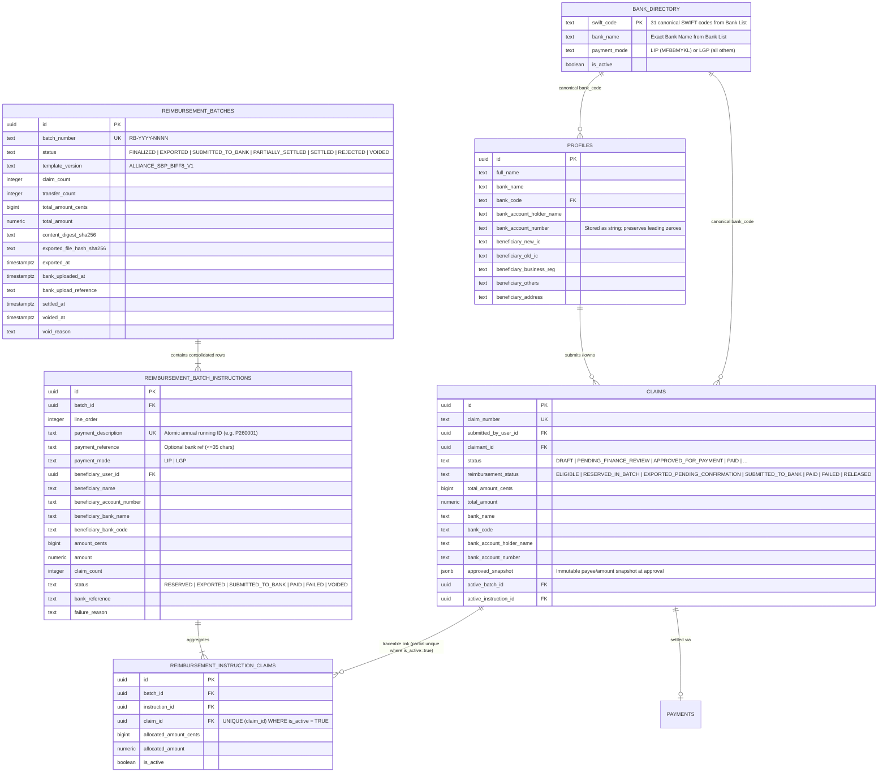
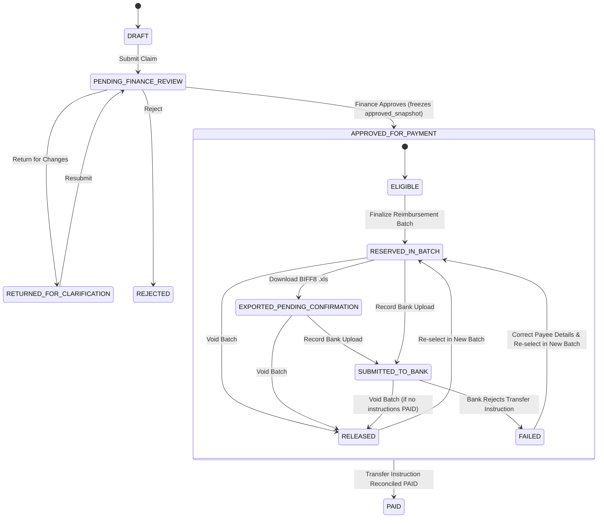
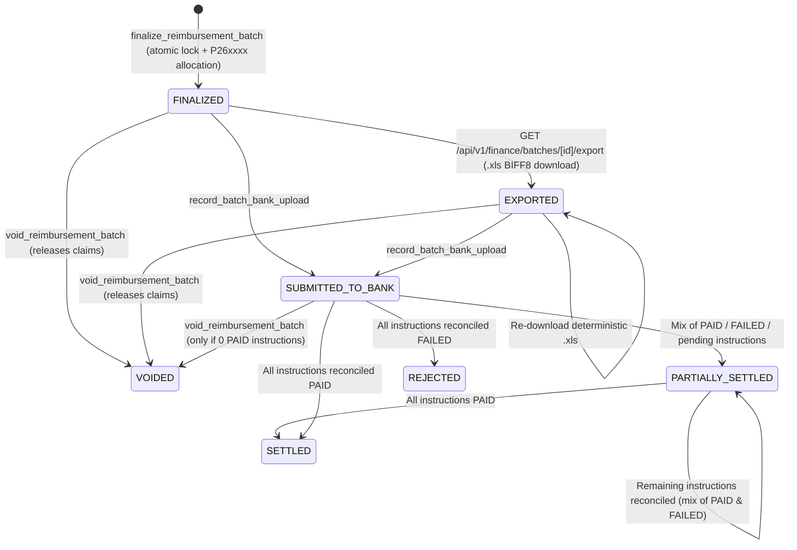

# Alliance Bank Bulk Reimbursement Architecture & Operational Guide

## 1. Overview

This document defines the architecture, database schema, state machines, 12-column BIFF8 `.xls` mapping contract, and Alliance Bank portal acceptance checklist for the **Harvest Generation Claims Portal (`HG-Claims`)** bulk reimbursement workflow.

### Core Separation of Concerns
1. **Approval $\neq$ Payment**: Approving a claim transitions its approval status to `APPROVED_FOR_PAYMENT`, snapshots the approved payee/amount details into `claims.approved_snapshot`, and sets `claims.reimbursement_status = 'ELIGIBLE'`. It does **not** mark the claim `PAID`.
2. **Export $\neq$ Settlement**: Finalizing a reimbursement batch reserves claims (`RESERVED_IN_BATCH`) and generates immutable transfer instructions (`reimbursement_batch_instructions`) with atomic annual `Payment Description` running numbers (`P<YY><NNNN>`). Downloading the BIFF8 `.xls` file transitions the batch to `EXPORTED` and records the file's SHA-256 digest (`exported_file_hash_sha256`), without marking claims `PAID`.
3. **Transfer-Level Reconciliation**: Finance explicitly records bank portal upload (`SUBMITTED_TO_BANK`) and reconciles individual transfer rows as `PAID` (creating `payments` rows and transitioning linked claims to `PAID`) or `FAILED` (recording the bank rejection reason and releasing linked claims back to `APPROVED_FOR_PAYMENT` + `reimbursement_status = 'FAILED'` for correction and re-batching).

---

## 2. Entity-Relationship Diagram (ERD)

---

## 3. Lifecycle State Diagrams

### 3.1 Claim Approval vs. Reimbursement State Machine

### 3.2 Reimbursement Batch State Machine

---

## 4. Reviewed 12-Column `Sheet1` Mapping Table

Pinned in [`src/lib/constants/HG_Bank_Template_Contract.json`](../src/lib/constants/HG_Bank_Template_Contract.json) and enforced by [`src/lib/banking/bank-export-adapter.ts`](../src/lib/banking/bank-export-adapter.ts):

| Col # | Exact `Sheet1` Row-1 Header | Field Status | Source Field Priority | Transformation / Validation Rule | Excel Cell Type |
| :--- | :--- | :--- | :--- | :--- | :--- |
| **1** | `Payment Mode` | **New (Derived)** | Derived from `beneficiary_bank_code` via `getPaymentModeForBankCode()` | `LIP` if `beneficiary_bank_code === 'MFBBMYKL'` (Alliance Bank Malaysia Berhad); `LGP` for all other 30 banks in `Bank List`. | String (`"s"`) |
| **2** | `Beneficiary Name` | **New + Existing Fallback** | `approved_snapshot.bank_account_holder_name` $\rightarrow$ `claim.bank_account_holder_name` $\rightarrow$ `profile.bank_account_holder_name` $\rightarrow$ `claim.claimant_name` | Trimmed, normalized whitespace, formula-injection escaped (`=`, `+`, `-`, `@` prefixed with `'`). Required. | String (`"s"`) |
| **3** | `Beneficiary Account / DuitNow ID Number` | **Existing (Hardened)** | `approved_snapshot.bank_account_number` $\rightarrow$ `claim.bank_account_number` $\rightarrow$ `profile.bank_account_number` | Spaces/hyphens stripped; 5–34 alphanumeric characters; **stored and written as text** so leading zeroes (e.g. `"001234567890"`) are never stripped or converted to scientific notation. | String (`"s"`) |
| **4** | `Beneficiary Bank Code / DuitNow ID Type` | **New** | `approved_snapshot.bank_code` $\rightarrow$ `claim.bank_code` $\rightarrow$ `resolveCanonicalBank(claim.bank_name).swiftCode` | Must match one of the exact 31 SWIFT codes in `Bank List` (`public.bank_directory`). Rejects unknown banks and the handwritten note typo `MFBBMYLK`. | String (`"s"`) |
| **5** | `Amount` | **Existing (Integer-Cent Hardened)** | `SUM(reimbursement_instruction_claims.allocated_amount_cents) / 100` | Computed strictly in integer sen (`bigint`), formatted as MYR numeric with 2 decimal places (`z: "0.00"`). Must be $> 0$. | Number (`"n"`, `z: "0.00"`) |
| **6** | `Payment Description` | **New (Atomic Running Counter)** | `reimbursement_batch_instructions.payment_description` (`private.next_payment_description(year)`) | Annual running identifier `P` + 2-digit year + 4+ digit sequence (`P260001`, `P260002`, ...). **Never** uses free-form claim purpose/description because one transfer row can consolidate multiple claims. | String (`"s"`) |
| **7** | `Payment Reference` | **New (Optional)** | `reimbursement_batch_instructions.payment_reference` | Optional bank reference ($\le 35$ chars); defaults to blank `""` matching `SBP_Sample - Copy.xls`. Distinct from `Payment Description`. | String (`"s"`) |
| **8** | `Beneficiary New IC No` | **New (Optional)** | `approved_snapshot.beneficiary_new_ic` $\rightarrow$ `claim.beneficiary_new_ic` $\rightarrow$ `profile.beneficiary_new_ic` | Optional Malaysian NRIC string; defaults to `""`. | String (`"s"`) |
| **9** | `Beneficiary Old IC No` | **New (Optional)** | `approved_snapshot.beneficiary_old_ic` $\rightarrow$ `claim.beneficiary_old_ic` $\rightarrow$ `profile.beneficiary_old_ic` | Optional Old IC string; defaults to `""`. | String (`"s"`) |
| **10** | `Beneficiary Business Registration` | **New (Optional)** | `approved_snapshot.beneficiary_business_reg` $\rightarrow$ `claim.beneficiary_business_reg` $\rightarrow$ `profile.beneficiary_business_reg` | Optional SSM/Business Reg string; defaults to `""`. | String (`"s"`) |
| **11** | `Beneficiary Others` | **New (Optional)** | `approved_snapshot.beneficiary_others` $\rightarrow$ `claim.beneficiary_others` $\rightarrow$ `profile.beneficiary_others` | Optional passport/other ID string; defaults to `""`. | String (`"s"`) |
| **12** | `Beneficiary Address` | **New (Optional)** | `approved_snapshot.beneficiary_address` $\rightarrow$ `claim.beneficiary_address` $\rightarrow$ `profile.beneficiary_address` | Optional beneficiary address string; defaults to `""`. | String (`"s"`) |

---

## 5. Consolidation Rules

Multiple approved claims are consolidated into a single `reimbursement_batch_instructions` row **if and only if** all of the following match:
1. **Verified Beneficiary User ID**: `claim.claimant_id || claim.submitted_by_user_id` (two different users are **never** merged even if their names and account numbers match).
2. **Normalized Account Holder Name**: `beneficiary_name.toUpperCase().replace(/\s+/g, " ")`.
3. **Canonical Bank SWIFT Code**: `bank_code` (from the 31-bank directory).
4. **Normalized Account / DuitNow ID String**: `bank_account_number`.
5. **Payment Mode & Currency**: `payment_mode` (`LIP` or `LGP`) and `currency` (`MYR`).
6. **Optional Identity Fields**: `beneficiary_new_ic`, `beneficiary_old_ic`, `beneficiary_business_reg`, `beneficiary_others`, `beneficiary_address`.

---

## 6. Alliance Bank Portal Acceptance Test Checklist

Before uploading the first production reimbursement batch to Alliance Bank BizSmart / Bulk Payment Portal, Finance and Engineering must complete the following verification steps:

- [ ] **1. Confirm Canonical Alliance Bank Code (`MFBBMYKL` vs Handwritten Note `MFBBMYLK`)**
  - In `SBP_Sample - Copy.xls`, `Bank List` row 13 and sample rows 2–5 use **`MFBBMYKL`** (`Alliance Bank Malaysia Berhad`), whereas explanatory Note row 14 contains a transposed-letter typo **`MFBBMYLK`**.
  - Our exporter emits **`MFBBMYKL`** and explicitly rejects `MFBBMYLK`. Confirm with Alliance Bank support that `MFBBMYKL` passes portal validation.
- [ ] **2. Verify Text (`"s"`) vs Numeric Cell Type for `Beneficiary Account / DuitNow ID Number`**
  - To prevent Excel from stripping leading zeroes (e.g. `001234567890`) or converting 16-digit account numbers into scientific notation, Column 3 is written as an explicit BIFF8 text cell (`t: "s"`).
  - Upload a 2-row test `.xls` file (one `LIP` Alliance Bank row, one `LGP` interbank row) to the Alliance Bank portal validation screen (without authorizing release) and confirm the portal accepts text-typed account cells.
- [ ] **3. Verify `Bank List` Second Worksheet Requirement**
  - The exported `.xls` preserves both worksheets in exact order: `Sheet1` followed by `Bank List` (31 banks), with all illustrative sample rows and explanatory `Notes` rows omitted from `Sheet1`. Confirm the portal accepts the 2-sheet workbook without warnings.
- [ ] **4. Verify `Payment Description` (`P260001`) & `Payment Reference` Constraints**
  - Confirm maximum character length and character-set rules on the bank portal for Column 6 (`Payment Description`, formatted as `P<YY><NNNN>`) and Column 7 (`Payment Reference`, optional $\le 35$ chars).
- [ ] **5. Reconcile First Test Batch End-to-End**
  - After uploading to the bank portal, record the portal reference via **Mark Uploaded to Bank** in `/finance/batches/[id]`, then test marking individual transfer rows as **Paid** (verifying all constituent claims transition to `PAID`) or **Failed** (verifying constituent claims are released for re-queueing).
