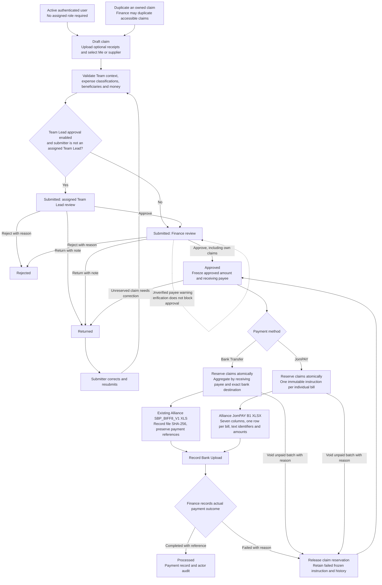
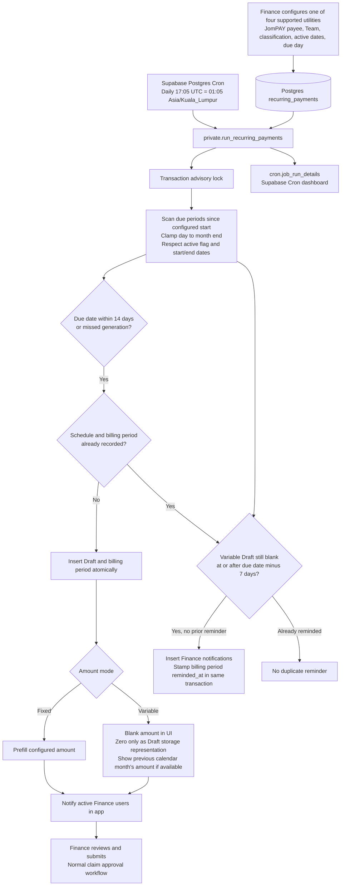

# HG-Claims v2 workflows

The database owns authorization, validation, routing, snapshots, reservations, and settlement. Next.js API routes authenticate sessions and issue transactional commands. Browser permissions provide interaction guidance; they do not grant database access.

The six primary display statuses are Draft, Submitted, Returned, Rejected, Approved and Processed. Historical Cancelled records retain a separate label. Internal stored statuses (`PENDING_MINISTRY_APPROVAL`, `PENDING_FINANCE_REVIEW`, `APPROVED_FOR_PAYMENT`, `PAID`) and distinct banking states remain intact. A Team Lead decision is recorded in workflow history and leaves the claim Submitted for Finance. Exporting or recording an upload never sets Processed.

Team assignments are checked for every Team Lead action. Merely choosing a Team does not grant membership or visibility. In-flight workflow snapshots retain their Team Lead review if the configuration is later disabled; an active reviewer must remain assigned until those claims progress. Finance classification changes to a pending claim's Team rebuild its review workflow. Approval histories are retained.

Duplicate Claim creates a new Draft and attachment rows. Part 1 is claimant/payee identity, contact details and payment destination. Part 2 is Team, current date default, purpose, internal reference, context and all expense items. All Part 2 values are cleared/defaulted. Files are shared by storage path through independent attachment rows. Detaching or deleting a duplicate does not delete storage objects or original attachment rows. Supplier snapshots remain unchanged on save unless the submitter explicitly refreshes the supplier details.

## Persistent recurring billing

Generation is retry-safe through the advisory lock and unique `(schedule_id, period)` constraint. One active schedule per configured payee prevents accidental duplicate configuration. Missed executions catch up eligible periods, including periods whose due dates have passed. A due day of 31 uses February 28/29 or the final day of other shorter months. A new Draft and its period commit together. Recurring bill records are retained; deactivate the schedule to stop future generation. There are no bill-variation alerts or anomaly thresholds.

Install the persistent job using `supabase/operations/install-recurring-job.sql` during deployment. Its execution does not depend on a Vercel process remaining alive. Monitor the named job daily in the Supabase Cron dashboard or with the query in that script. Failed transactions roll back and the next execution catches up without duplicate periods. See the implementation report for deployment and rollback steps.
